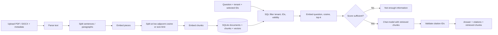
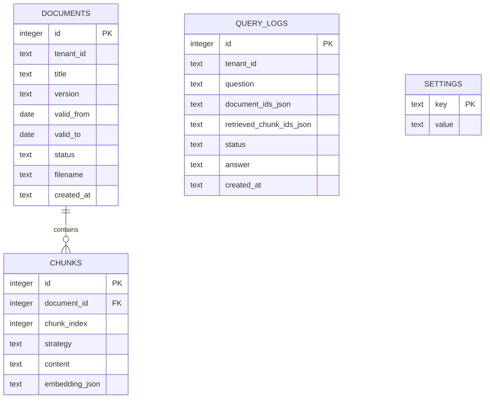

# NUSAskify — Internal Policy Q&A

Ứng dụng RAG demo: upload PDF/DOCX, chọn tài liệu theo tenant, tìm đoạn liên quan và tạo câu trả lời kèm nguồn. Tài liệu mẫu là dữ liệu hư cấu, không chứa thông tin công ty thật.

## Phân tích và lựa chọn

- **Backend/API:** Python 3.10+, FastAPI, Swagger UI (`/docs`).
- **Frontend:** HTML/CSS/JavaScript thuần, gọi cùng origin.
- **Vector store:** SQLite lưu vector dạng JSON trong bảng `chunks`. SQL lọc tenant, document và ngày hiệu lực **trước** khi Python tính cosine và lấy top-k. Đây là exact search, phù hợp dữ liệu nhỏ; không có ANN index, sẽ chậm khi dữ liệu lớn. SQLite `doc_scope` và `chunk_document` là metadata index, không phải vector index.
- **Mô hình:** Sentence Transformers chạy local `sentence-transformers/paraphrase-multilingual-MiniLM-L12-v2` cho cả câu hỏi và chunk; API tương thích OpenAI (`qwen-3.7-flash`) tạo câu trả lời. Câu hỏi và các chunk được chọn sẽ gửi tới nhà cung cấp LLM, vì vậy chỉ dùng tài liệu không nhạy cảm. Chiều vector được lấy từ model và lưu cùng tên model; từ chối nếu model/kích thước không khớp dữ liệu cũ. Đổi model cần database mới và ingest lại.
- **Các ngưỡng:** cosine của chunk xếp đầu mặc định `0.30`; semantic split mặc định `0.55`, tối đa 1.200 ký tự/chunk. Đây là ngưỡng minh họa cần hiệu chỉnh bằng tập đánh giá thực tế; điểm cosine cao không chứng minh câu trả lời đúng.

### Luồng



Structure-based chunking chạy song song theo paragraph, lưu vector riêng; dùng `strategy: "structure"` ở `/api/search` để so sánh với `"semantic"` mặc định. Semantic chunking dùng cosine giữa từng cặp câu/đoạn liền kề, không chỉ chia theo độ dài. Với một paragraph chứa hai chủ đề, semantic có thể tách và tăng độ chính xác; structure giữ ngữ cảnh liền mạch hơn và không phụ thuộc embedding, nhưng có thể trộn chủ đề. Kết quả thực tế phụ thuộc model/ngưỡng; chưa có benchmark với embedding local trên máy này. Ví dụ kiểm thử có paragraph “Remote work three days. Annual leave eighteen days.”, embedding giả lập tách semantic thành 2 chunk và structure thành 1 chunk. Đây là kiểm thử thuật toán, không phải bằng chứng chất lượng retrieval của model thật.

### Data model



`documents` unique theo `(tenant_id, title, version)`; ngày hiệu lực inclusive. Upload version mới có cùng tenant và title, bắt đầu muộn hơn và chồng khoảng hiệu lực: hệ thống rút ngắn `valid_to` của version cũ đến ngày trước `valid_from` của version mới, trong cùng transaction. Version mới bắt đầu trước hoặc cùng ngày với version đang chồng lấn bị từ chối; các khoảng không chồng lấn có thể upload theo bất kỳ thứ tự nào. Xóa document cascade sang chunks. `query_logs` lưu dữ liệu câu hỏi và câu trả lời: chỉ dùng dữ liệu không nhạy cảm trong demo.

## Chạy ứng dụng

1. Cài Python 3.10+ và đảm bảo có Internet để cài thư viện và tải model embedding lần đầu. Không cần Ollama. Model embedding sẽ được tải tự động vào `.cache/models` khi upload hoặc tìm kiếm lần đầu.

2. Tại thư mục repo, tạo file cấu hình từ mẫu và điền base URL và API key của nhà cung cấp vào `.env`:

   ```sh
   cp .env.example .env
   ```

   Đặt `LLM_BASE_URL` là base URL của provider (ví dụ `https://host/v1`, không gồm `/chat/completions`), `LLM_API_KEY` là key và `LLM_MODEL=qwen-3.7-flash`. Ứng dụng gọi `POST {LLM_BASE_URL}/chat/completions` với Bearer token và yêu cầu `response_format: {"type":"json_object"}`; provider/model cần hỗ trợ JSON mode. Kiểm tra chính xác base URL và model ID theo nhà cung cấp. Nếu trước đây bạn đã tạo `.env` với biến `DEEPSEEK_*`, hãy thay bằng các biến `LLM_*` mới.

   Các biến `OLLAMA_URL` và `EMBED_MODEL` cũ không còn được sử dụng; không cần xóa chúng để chạy. File `.env` được nạp tự động khi backend khởi động và đã được đưa vào `.gitignore`. Biến cũ `SCORE_THRESHOLD` không còn sử dụng; có thể đặt `RETRIEVAL_MIN_SCORE` để điều chỉnh ngưỡng mới. Không chia sẻ API key hoặc commit file này. Sau đó cài dependencies và chạy server:

   ```sh
   python3 -m venv .venv
   . .venv/bin/activate
   pip install -r requirements.txt
   python scripts/create_samples.py
   uvicorn app.main:app --reload
   ```

3. Trong terminal khác (cùng môi trường ảo), nạp 5 tài liệu mẫu một lần:

   ```sh
   python scripts/seed.py
   ```

   Hoặc upload thủ công từ UI theo `sample_docs/manifest.json`. Chạy seed lần hai trên cùng database sẽ báo trùng version; muốn làm lại, dừng server và xóa `data.db` (dữ liệu demo sẽ mất).
4. Mở `http://127.0.0.1:8000`, chọn tenant **Acme**, chọn các tài liệu và hỏi `How many days can I work from home?`. Trang `http://127.0.0.1:8000/docs` cho phép thử API; cung cấp header `X-Tenant-Id` cho từng request.

Cấu hình `LLM_API_KEY`, `LLM_MODEL`, `LLM_BASE_URL`, `DATABASE_PATH`, `LOCAL_EMBED_MODEL`, `RETRIEVAL_MIN_SCORE`, `CHUNK_THRESHOLD` trong `.env` hoặc biến môi trường. Biến môi trường đã đặt sẵn có ưu tiên. Service trả 503 nếu thiếu key hoặc embedding model không khả dụng, và 502 nếu API LLM trả lỗi. `/api/ask` chỉ gọi LLM nếu điểm chunk cao nhất đạt ngưỡng, sau đó gửi toàn bộ top 3 để LLM tìm bằng chứng và từ chối nếu không đủ thông tin; `/api/search` không gọi chat API. PDF scan không có text layer cần OCR ngoài phạm vi bài.

### Ví dụ API

```sh
curl -X POST http://127.0.0.1:8000/api/search \
  -H 'Content-Type: application/json' -H 'X-Tenant-Id: acme' \
  -d '{"question":"How many days can I work from home?","document_ids":[1,2,3,4],"top_k":3,"strategy":"semantic"}'
```

ID trong ví dụ cần thay bằng ID từ `GET /api/documents`. Đổi `strategy` thành `structure` để so sánh danh sách chunk và score. `/api/ask` nhận `question`, `document_ids`; trả `status`, `answer`, `citations`, `chunks`. Các ID không thuộc tenant hoặc không còn hiệu lực không xuất hiện trong kết quả; chọn danh sách rỗng bị từ chối.

## Kết quả kiểm thử và chẩn đoán

Chạy `.venv/bin/python -m pytest -q`: **7 passed**. Các kiểm thử tích hợp dùng SQLite tạm, FastAPI TestClient và embedding/chat giả lập xác định; chúng không kiểm chứng chất lượng mô hình thật hoặc UI trên trình duyệt.

| Case | Kết quả / giới hạn |
|---|---|
| TC1 | Pass với model giả: câu hỏi “work from home” truy xuất chunk “Remote work”; chat giả trả 3 ngày và citation. Chưa xác nhận khả năng diễn đạt lại của embedding local và chat model thật. |
| TC2 | Với embedding giả, remote current cosine **1.0**, annual leave **0.0**; hai chunk đủ điều kiện trong fixture này, không có top 3 thứ ba. Mapping giả chủ động đưa `home` và `remote` vào cùng vector; đây không phải bằng chứng về semantic model thật. Dùng ví dụ `/api/search` sau seed để ghi top 3 score thực tế. |
| TC3 | Pass với model giả: câu hỏi cafeteria có vector trực giao, score dưới ngưỡng và trả `not enough information`. Với câu hỏi lạc đề nhưng similarity cao, chat còn phải nhận biết thiếu thông tin. |
| TC4 | Pass: version cũ bị rút `valid_to` về 2024-12-31 và không được retrieval ở thời điểm kiểm thử; version mới được dùng. |
| TC5 | Pass: chunk Northstar không vào retrieval Acme, kể cả khi ID được gửi; endpoint debug/delete cũng không truy cập được. |
| TC6 | Pass: chỉ chọn Annual Leave thì không có chunk Remote Work và câu hỏi work from home bị từ chối với vector giả. |
| TC7 | Pass cho kiểm tra cơ học: citation ID phải thuộc các chunk đã retrieve khi điểm cao nhất vượt ngưỡng; ID giả bị từ chối với lỗi 502; ID dạng `chunk:13` được chuẩn hóa và đối chiếu với chunk đã truy xuất. Chưa tự động chứng minh từng claim được chunk hỗ trợ: cần đọc đối chiếu hoặc dùng đánh giá entailment. |
| TC8 | Ví dụ phân tích: hỏi “Does Acme allow five remote days?”; đoạn Northstar nói “five remote days” có thể giống câu hỏi nhất nhưng sai tenant. Filter loại nó trước top-k. Ngay trong cùng tenant, đoạn nói “five days are prohibited” cũng có thể giống câu hỏi hơn đoạn trả lời đúng: similarity không hiểu đầy đủ phủ định và hiệu lực. Chưa đo score thực tế. |

Để phân biệt lỗi: xem `/api/search` hoặc danh sách chunk. Nếu chunk đúng không nằm trong top-k, đây là vấn đề ingestion/chunking/filter/embedding/retrieval; nếu chunk đúng đã có nhưng câu trả lời sai hoặc trích dẫn không hỗ trợ, đây là vấn đề generation/grounding. Thử cả hai `strategy`, ghi câu hỏi, top 3 chunk/score và kiểm tra từng claim với nguồn.

## Giới hạn demo

`X-Tenant-Id` chỉ mô phỏng tenant, không phải xác thực hay phân quyền: người gọi có thể tự đổi header. Không triển khai công khai cho dữ liệu thật khi chưa bổ sung authentication, authorization, bảo vệ prompt injection và kiểm soát log. Hệ thống kiểm tra citation trỏ đúng chunk nhưng không đảm bảo nguồn thực sự chứng minh mọi claim; người dùng phải đối chiếu nội dung. Ngày hiệu lực dựa trên ngày cục bộ của server. Các yêu cầu embedding và API LLM đồng bộ có thể mất thời gian và các tệp lớn cần giải pháp background/index chuyên dụng.
